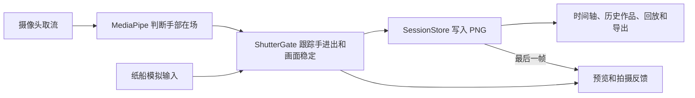

# 逐格工作台 · 课堂验收

定格拍摄时，创作者需要反复移动道具、收手、按快门。逐格工作台把按快门交给程序，并在预览里显示上一帧的叠影，方便控制道具每次移动的距离。用普通摄像头和桌面文具就能完成一段动画。

## 课堂演示

如果现场摄像头不可用，双击「体验模拟拍摄.cmd」。约 18 秒后，纸船演示会收满 8 帧并提示回放。可以逐帧查看，选帧后从这帧回放，也能导出 GIF 或 MP4。演示构造纸船画面和手部信号，自动快门、时间轴、回放及导出与实拍共用同一套实现。

实拍使用固定镜头和颜色反差明显的道具，例如在白纸上拍一块深色橡皮。按照下表操作，直接观察时间轴和画面下方的状态。

| 操作 | 可观察结果 |
| --- | --- |
| 摆好道具后打开摄像头，保持静止 | 稳定进度走完，时间轴出现第一帧 |
| 伸手挪动道具后收手 | 等到画面稳定，进度变绿，时间轴增加一帧 |
| 只伸手后收手，道具原样 | 状态提示跳过，帧数不变 |
| 勾选「上一帧叠影」，再挪动道具 | 取景显示原位置的叠影，保存的原图和导出成品不包含叠影 |
| 暂停自动快门，收手后单击「手动拍一帧」 | 每次点击补一帧，恢复自动快门后可继续摆拍 |
| 停止取景，新建另一个项目，再用「打开作品…」打开之前的编号 | 旧帧回到时间轴，打开摄像头后可继续拍摄或直接导出 |
| 点击一张缩略图，再逐帧移动 | 取景区停在选中的原图，时间轴跟随显示当前位置。返回取景后恢复正常拍摄 |
| 导出 GIF 和 MP4，打开成品 | GIF 循环播放，MP4 按所选帧率播放一次 |

续拍时尽量保持原机位。如果机位或画面尺寸变动较大，可以手动补拍一帧作为新的参考，再恢复自动快门。

## 工程实现



- `sources.py` 在后台读取摄像头帧并识别手部，界面读取最新的观察结果。手部出现次数随画面传递，中间预览帧被丢弃时仍能保留这次手部介入。
- `shutter.py` 等待手离开和画面稳定，再检查道具是否产生局部变化。曝光变化以全局中位数补偿，画面变化则通过局部像素聚簇判断。固定机位下，一次摆放最多自动收一帧。
- `app.py` 串联拍摄、补拍、叠影、作品与导出。叠影使用缓存的最后一帧，预览刷新时无需扫描作品目录。打开作品或选择导出文件期间，自动快门暂停处理画面。
- `sessions.py` 用独立目录保存每件作品的按序 PNG。历史作品帧全部读取成功后才切换，读取失败时仍可留在当前作品。原始帧、GIF 和 MP4 都先写临时文件，成功后再替换目标。MP4 编码后会校验画面尺寸和帧数。首帧尺寸为奇数时补一行或一列像素，尺寸不同的照片会等比装入画面。
- `studio_ui.py` 显示取景、逐帧导航、拍摄状态、时间轴及项目选择。所有摄像头判断与文件写入由其他模块负责。

## 自动快门对照实验

安装依赖后，在项目目录运行以下命令。

```powershell
.\.venv\Scripts\python.exe -B verify_capture.py
.\.venv\Scripts\python.exe -B -m unittest discover -s tests -v
```

`verify_capture.py` 用 10 Hz 的确定性合成画面，给两种策略输入同样的画面和手部信号。对照组在每次检测到手从有到无时立即拍照。每个案例预先指定有效收帧时间窗，一段时间窗只计一次命中，窗外或重复的照片计为误拍，无有效照片则计为漏拍。

| 案例 | 预期 | 工作台收帧（秒） | 仅看手部离开的对照（秒） |
| --- | --- | --- | --- |
| 正常移动 | 收一帧 | 1.00 | 0.30 |
| 原样摆回 | 跳过 | — | 0.30 |
| 收手后桌面晃动 | 等稳定再收一帧 | 2.20 | 0.30，过早 |
| 短暂漏检手部 | 真正收手后拍一帧 | 1.60 | 0.30、0.90，第一张过早 |
| 道具移动 2 像素 | 收一帧 | 1.00 | 0.30 |
| 只有全局亮度上升 | 跳过 | — | 0.30 |

六组输入中，工作台命中 4 次、误拍 0 次、漏拍 0 次。对照组命中 3 次、误拍 4 次、漏拍 1 次。稳定等待让正常场景的收帧延后约 0.7 秒，在这组输入上换来了较少的误拍。实验测量自动快门的判定逻辑，使用的是预设手部信号。真实光照、遮挡和俯拍角度下的手部检测表现还需要实体摄像头验证。
